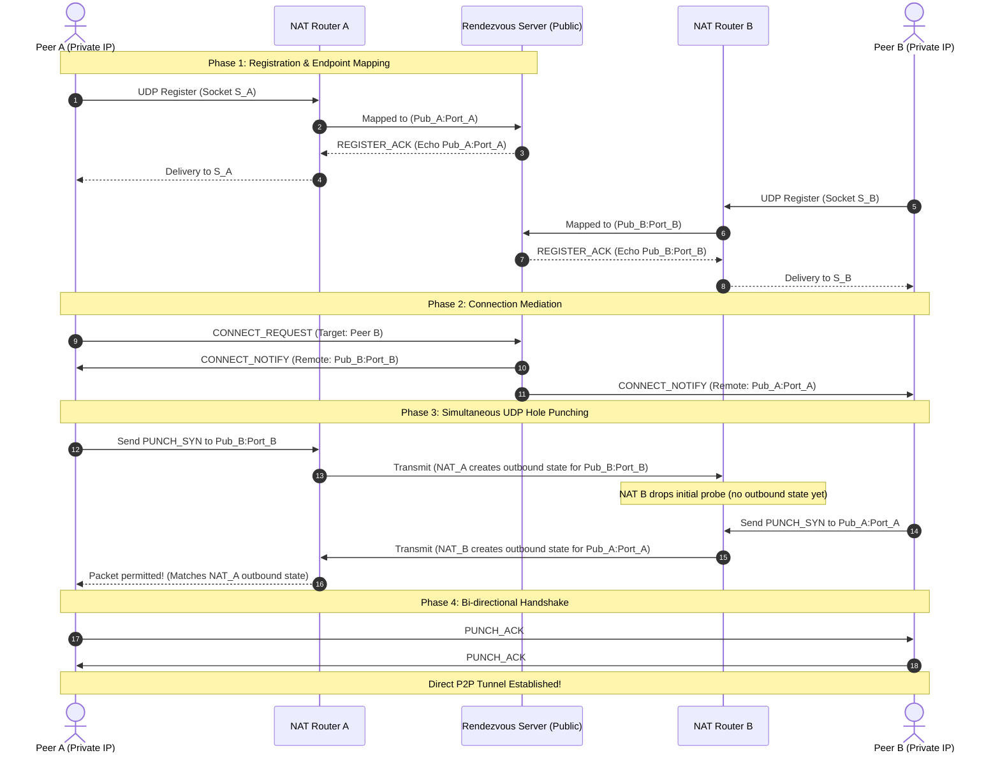

# PeerLink — System Architecture & Network Design

**Project:** PeerLink Peer-to-Peer Communication System  
**Lead Author:** Mubashir Ali (23K-6077)  
**Role:** Peer Discovery and NAT Traversal  
**Branch:** `feature/peer-discovery`  
**Last Updated:** November 14, 2026  

---

## 1. System Overview

PeerLink is a decentralized peer-to-peer (P2P) desktop communication application supporting real-time messaging, chunked file transfers, custom reliable UDP transports, and network performance instrumentation.

Because peers reside across varying network topologies (local subnets, private Wi-Fi networks, and mobile carrier networks behind NAT gateways), PeerLink employs a tiered discovery and connection architecture:

```
+-------------------------------------------------------------------------+
|                          Application Layer                              |
|         (Text Chat, File Transfer Engine, Heartbeat Monitor)            |
+-------------------------------------------------------------------------+
                                    |
+-------------------------------------------------------------------------+
|                  Peer Discovery & Traversal Layer                       |
|  +--------------------+  +---------------------+  +------------------+  |
|  |   UDP Broadcast    |  |    UDP Multicast    |  | Rendezvous Server|  |
|  |  (Local Subnet)    |  | (IGMP Group Scoped) |  |   & Hole Puncher |  |
|  +--------------------+  +---------------------+  +------------------+  |
+-------------------------------------------------------------------------+
                                    |
+-------------------------------------------------------------------------+
|                           Transport Layer                               |
|        +-----------------------------------+  +-------------------+     |
|        |           TCP Transport           |  |   Reliable UDP    |     |
|        | (Framing, Stream, Nagle Analysis) |  | (ARQ, SW, GBN, SR)|     |
|        +-----------------------------------+  +-------------------+     |
+-------------------------------------------------------------------------+
                                    |
+-------------------------------------------------------------------------+
|                     Operating System Network Sockets                    |
|                        (IPv4 UDP & TCP Sockets)                         |
+-------------------------------------------------------------------------+
```

---

## 2. Peer Discovery Mechanisms

PeerLink implements three distinct discovery protocols, matching the peer's operating environment:

### A. UDP Broadcast Discovery (Local LAN)
- **Target Address:** `<broadcast>` (`255.255.255.255`)
- **Default Port:** `5002`
- **Module:** `src/discovery/broadcast.py` (`UDPBroadcastDiscovery`)
- **Mechanism:**
  - Nodes periodically pulse discovery beacons across the local broadcast domain.
  - Broadcast sockets are bound with `SO_BROADCAST` and `SO_REUSEADDR`.
  - Self-sent broadcast frames are filtered by comparing the sender's `peer_id`.
  - Inactive peers are automatically pruned after a configurable timeout (default 6.0s).
- **Pros:** Zero configuration; instantly works on any unmanaged LAN or home Wi-Fi.
- **Cons:** Flocks every host on the subnet regardless of whether they run PeerLink; routers drop broadcast packets at subnet boundaries.

### B. UDP Multicast Discovery (Subnet / Workgroup)
- **Multicast Group:** `239.255.0.1` (RFC 2365 Administratively Scoped IPv4 Multicast)
- **Default Port:** `5003`
- **Module:** `src/discovery/multicast.py` (`UDPMulticastDiscovery`)
- **Mechanism:**
  - Participating nodes join the multicast group via IGMP using `socket.IP_ADD_MEMBERSHIP`.
  - Transmitters configure `IP_MULTICAST_TTL` (default: 2) and enable `IP_MULTICAST_LOOP` for local testing.
  - Network Interface Cards (NICs) filter multicast traffic at Layer 2/3 hardware levels.
- **Pros:** Efficient; only interested PeerLink nodes receive packet interrupts, significantly reducing local network noise.
- **Cons:** Some enterprise Wi-Fi routers disable multicast forwarding or IGMP snooping.

### C. Rendezvous Server (WAN / Cross-Network Discovery)
- **Default Server Port:** `5004` (UDP)
- **Module:** `src/discovery/rendezvous_server.py` (`RendezvousServer`, `RendezvousClient`)
- **Mechanism:**
  - Acts as a lightweight signaling and STUN-like broker with a known public IP or hostname.
  - Inspects incoming datagram source addresses (`addr[0]:addr[1]`) to determine the peer's external **public mapped reflexive endpoint**.
  - Returns the mapped endpoint to the client in a `REGISTER_ACK` message.
  - Maintains a live registry of active peers and responds to `LIST_PEERS` and `GET_PEER` requests.
  - Handles `CONNECT_REQUEST` signaling to mediate simultaneous UDP hole punching between two peers.

---

## 3. NAT Traversal & UDP Hole Punching Architecture

### The NAT Barrier
Most consumer hosts reside behind Network Address Translation (NAT) gateways. NAT allows multiple private devices (`192.168.x.x` or `10.x.x.x`) to share a single public IP. When a host initiates an outbound UDP flow, the NAT router creates a translation mapping:

$$\text{Private IP:Port} \longleftrightarrow \text{Public Mapped IP:Port}$$

Inbound packets arriving from the Internet that do not match an existing translation table entry are dropped by the firewall. Consequently, two peers behind different NAT gateways cannot directly initiate a session to each other without assistance.

### NAT Classification

| NAT Type | Outbound Port Mapping Rule | Inbound Ingress Filtering Rule | UDP Hole Punching Feasibility |
|---|---|---|---|
| **Full Cone NAT** | Same public port for all outbound destinations | Any external host can send to mapped port | 100% Direct |
| **Restricted Cone NAT** | Same public port for all outbound destinations | Only external hosts that internal host has previously messaged can send back | 100% via Hole Punching |
| **Port-Restricted Cone NAT** | Same public port for all outbound destinations | External host IP **and** port must match previous outbound target | 100% via Simultaneous Hole Punching |
| **Symmetric NAT** | Unique public port allocated for every distinct destination endpoint | Only exact destination IP:port can reply | Direct Hole Punching Fails (Requires Relay/TURN) |

### The UDP Hole Punching Protocol Flow



---

## 4. Empirical Testing & Network Scenarios

During testing across different network environments:

### Scenario 1: Same Local Wi-Fi Subnet
- **Result:** Both Broadcast and Multicast discovery succeed within < 50ms.
- **Direct P2P:** Instant socket connectivity over private IPs without requiring Rendezvous mediation.

### Scenario 2: Wi-Fi to Mobile Hotspot (Cone NAT to Cone NAT)
- **Result:**
  1. Broadcast fails across distinct networks.
  2. Both peers successfully register with the Rendezvous Server.
  3. Simultaneous UDP hole punching succeeds within 1-2 probe packets.
  4. Sustained direct P2P socket communication confirmed with bidirectional ACK responses.

### Scenario 3: Mobile Hotspot with CGNAT (Carrier-Grade NAT) / Symmetric NAT
- **Limitation Documented:**
  - When mobile carriers deploy Symmetric NAT or Carrier-Grade NAT (CGNAT) with port-randomization, the public port assigned by NAT for traffic towards the Rendezvous Server differs from the port assigned when sending probes towards Peer B.
  - In Symmetric NAT topologies, hole punching requires port prediction techniques or fallback to relay servers (TURN).

---

## 5. Port Allocations & Protocol Directory

| Port Number | Protocol | Scope | Purpose | Module |
|---|---|---|---|---|
| **5000** | TCP | Host / P2P | Direct TCP peer chat and chunked file transfer | `src/transport/tcp/` |
| **5001** | UDP | Host / P2P | Raw and Reliable UDP file transfer | `src/transport/udp/` |
| **5002** | UDP Broadcast | Local Subnet (`255.255.255.255`) | LAN peer discovery beacons | `src/discovery/broadcast.py` |
| **5003** | UDP Multicast | Subnet Group (`239.255.0.1`) | Low-noise IGMP multicast discovery | `src/discovery/multicast.py` |
| **5004** | UDP Unicast | Global / WAN Server | Rendezvous registration and NAT signaling | `src/discovery/rendezvous_server.py` |
| Dynamic | UDP Unicast | Direct P2P | Ephemeral UDP hole punch tunnel endpoints | `src/discovery/hole_punching.py` |
